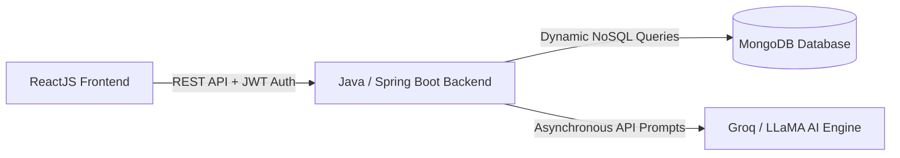

# 🚀 DevPrepPal - AI-Powered Placement Preparation Platform

DevPrepPal is an advanced, full-stack web application engineered to help computer science students and job seekers crack technical interviews. The platform features a decoupled architecture integrating AI automation, production-grade security, and dynamic data indexing.

---

## 🏗️ System Architecture & Data Flow



---

## 🛠️ Tech Stack

- **Frontend**: React 19, Vite, Tailwind CSS, Framer Motion, React Router, Axios
- **Backend**: Java 21, Spring Boot 3.5, Spring Security, Spring Data MongoDB, JWT (jjwt 0.12), Maven
- **Database**: MongoDB Atlas
- **AI Integration**: Groq API (LLaMA-3.1-8b-instant)
- **Deployment**:
  - Backend: **Render** (Docker / Java Web Service)
  - Frontend: **Vercel** (Vite SPA)

---

## 💻 Local Development

### 1. Prerequisites
- **Java 21** & **Maven 3.8+**
- **Node.js 18+** & **npm**

### 2. Run Backend (Spring Boot)
```bash
cd _backend/backend
./mvnw clean spring-boot:run
# On Windows PowerShell:
.\mvnw.cmd spring-boot:run
```
The backend starts on `http://localhost:8080`.

### 3. Run Frontend (React Vite)
```bash
cd client
npm install
npm run dev
```
The frontend starts on `http://localhost:5173`.

---

